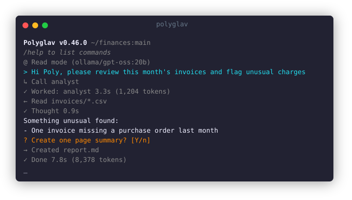

# Polyglav

<p align="center"></p>

**One agent, many heads**

<p>
  <a href="https://pypi.org/project/polyglav/"></a>
  <a href="https://polyglav.github.io/polyglav/"></a>
  =3.11">
  
  
  
</p>

Polyglav is an AI agent that lives in your terminal. You describe an outcome once, it breaks the job into steps, brings in specialist agents for each one, and lets them work through it in order, handing results from one to the next as they finish. Use it at the prompt when you want. Put it on a server and let it work. The name says it: poly means many, glav means heads.

## Why Polyglav

- **Unattended by design** - run it headless from the CLI, over the HTTP API, on a cron schedule, or as a fleet. Results land in append-only logs and optional webhook reports, with no dashboard to watch.
- **One prompt, many heads** - ask for an outcome, and Polyglav splits it across specialists that run one after another in the same process, one context at a time. As soon as one delivers, the next continues. No windows to switch.
- **It actually gets work done** - it reads and writes files, searches the web, runs commands, edits code, and commits, all behind permissions you control.
- **Grows with you** - reusable roles, skills, and plugins, durable plans and todos, bounded memory, scheduled jobs, and a fleet supervisor. Jobs, fleet, and MCP are bundled plugins, off by default.
- **Your machine, your keys** - keys, sessions, roles, teams, skills, and permissions stay on disk as text. Bring your own provider key, or run fully local.
- **Safe by default** - allow, ask, or deny by tool and category. File access outside your project asks first, a non-loopback API bind needs a token, and every action is on the record.
- **Extensible** - plugins add tools, providers, commands, roles, teams, skills, and report delivery. Email, Telegram, or Signal delivery can be added as plugins.
- **Zero dependencies** - pure Python standard library. No dependency supply chain to audit, no lockfile churn, and the code that runs is the code in this repository.
- **At home in the terminal** - a fast streaming REPL with a plain input prompt, a color-coded submitted line, dimmed thinking, hidden tool bodies, command completion, and history. No browser, no account, and no dashboard.
- **Many providers, any model** - Ollama, OpenAI, Groq, Anthropic, OpenCode, or any OpenAI-compatible endpoint, picked automatically from the address.

## What you can do with it

- **Ship a change end to end** - ask for a feature and let a planner, a programmer, and a reviewer work through it in order.
- **Plan a long run** - read mode can write a durable internal plan and todo under `.polyglav/`, so a long task keeps its instructions, decisions, role split, and current work across compaction and role switches.
- **Leave a job running** - schedule a cron job that refreshes docs, updates a changelog, or summarizes logs, then approve it and start the daemon.
- **Research and write** - point it at a folder of notes or papers and ask for a summary with sources.
- **Run many agents** - give each folder its own agent and let the fleet supervisor watch them.
- **Automate with the API** - drive the same loop from scripts, CI, or another program.

## How it works

1. **Ask** - describe an outcome to the assistant in one sentence.
2. **Compose** - for bigger work it designs a small team: the specialists and the order they run in.
3. **Run** - stages run one after another, each with its own tools and permissions.
4. **Continue** - the next agent continues from the previous result with its own session, so context moves forward without switching windows.
5. **Operate** - give it a project, a boundary, and a schedule. Check `/status`, the log, or a webhook report when you come back. Pause a long turn with Ctrl-C, `/continue`, or `/cancel`.

## Install

```bash
pipx install polyglav
polyglav
```

On first run, Polyglav asks for your provider, model, mode, and project setup. After that, it can run without you. You can rerun onboarding with `/onboard`, or change the connection later with `/connect` and `/model`.

For source installs, the REPL, the headless CLI, the HTTP API, Docker, plugins, and the full command reference, see [INSTALL.md](INSTALL.md).

## Learn more

- [AGENTS.md](AGENTS.md) - architecture and conventions
- [CONTRIBUTING.md](CONTRIBUTING.md) - the contribution workflow
- [INSTALL.md](INSTALL.md) - install, run, and command reference
- [VISION.md](VISION.md) - what Polyglav is and where it is going
- [docs/index.md](docs/index.md) - full documentation

## License

[MIT](LICENSE)
